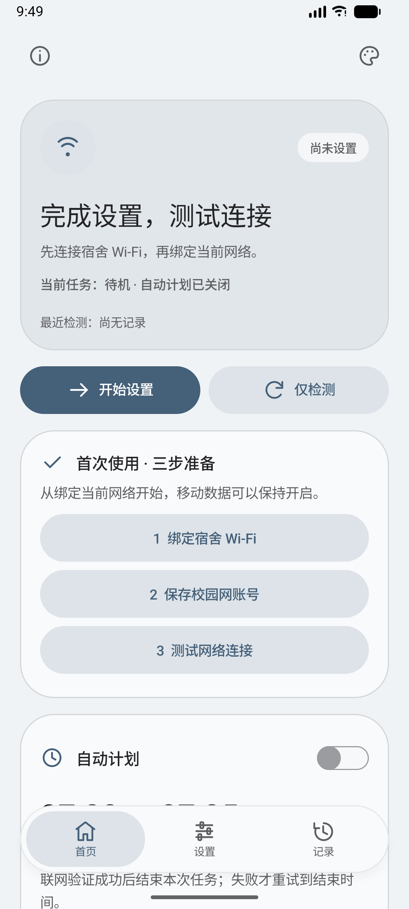
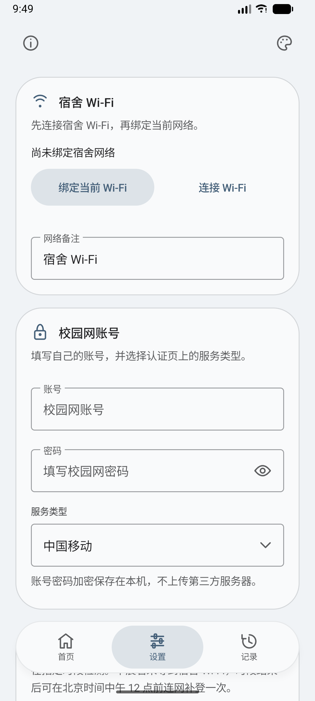
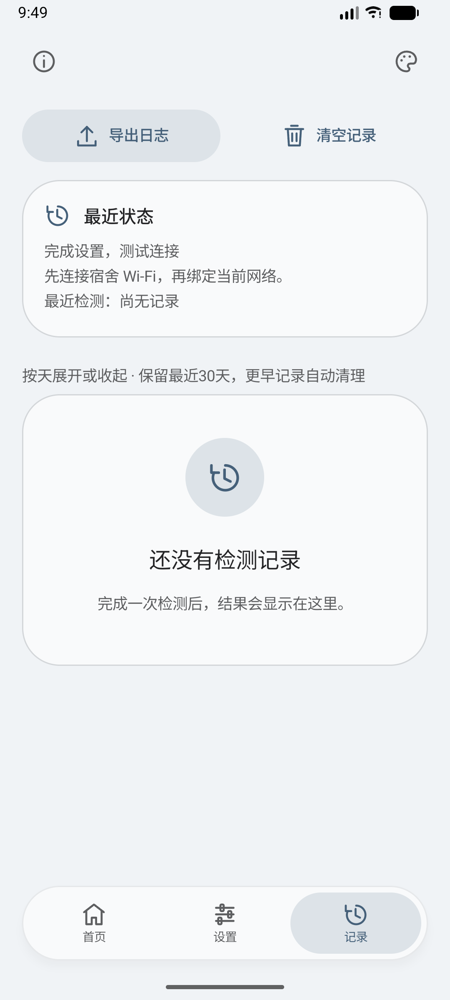
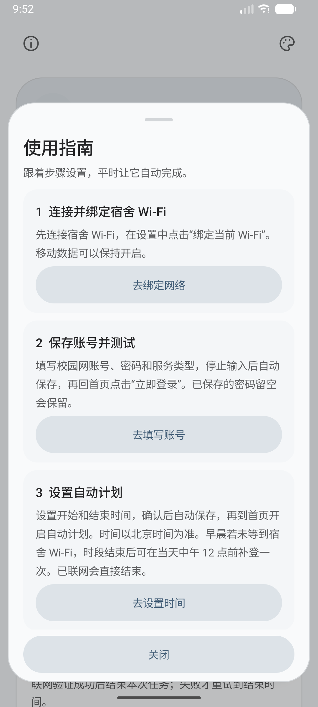
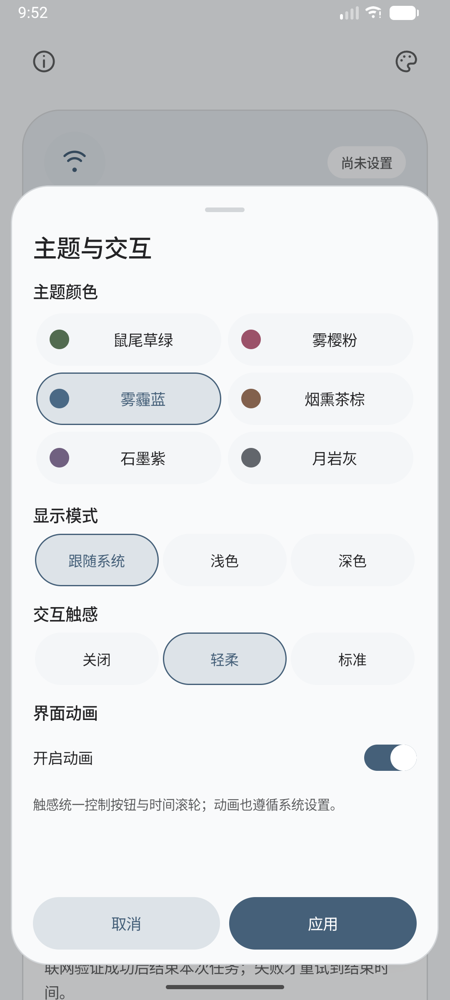

# 校园网助手｜安卓自动登录校园网

一款 Android 校园网助手：设置好账号和宿舍 Wi-Fi 后，可按每天或选定星期的时段，在后台自动检测网络，并在需要时尝试登录校园网。无需 Root 或 Termux。

**当前版本：1.5.8** · Android 8.0 及以上 · 原生 Java

## 立即下载

- **安卓用户：[下载校园网助手 1.5.8 安装包（APK）](https://github.com/v6rjhrny8d-hue/campus-portal-app/raw/refs/heads/main/releases/campus-portal-app-1.5.8.apk)**
- **开发者：[下载 1.5.8 原始源码压缩包（ZIP）](https://github.com/v6rjhrny8d-hue/campus-portal-app/raw/refs/heads/main/releases/campus-portal-app-1.5.8-source.zip)**

下载 APK 后在安卓手机上打开安装；系统可能要求允许浏览器或文件管理器安装应用。自动登录受校园网认证方式、系统后台限制和 Wi-Fi 状态影响，首次使用请先手动测试。

## 应用截图

以下图片直接截取自 Android 模拟器中运行的 1.5.8 版本，展示首次使用时的界面。

| 首页 | 设置 | 记录 |
| --- | --- | --- |
|  |  |  |

| 使用指南 | 主题与交互 |
| --- | --- |
|  |  |

## 功能

- 绑定宿舍网络，在选定 Wi-Fi 上检测并认证；已联网时结束任务，避免重复提交。
- 自定义定时时段、重复日期和检测间隔，并提供手动登录、连接记录和诊断功能。
- 早晨计划等待 Wi-Fi 就绪；符合条件时可在当天中午前安排一次补登。系统限制可能影响实际执行时间。
- 本地保存设置，使用 Android Keystore 加密凭据；提供运行权限和后台设置引导。

## 下载与使用

下载 [1.5.8 APK](releases/campus-portal-app-1.5.8.apk)，在 Android 设备上安装。已有旧版本的用户，需使用相同签名的安装包才能覆盖更新；更新后打开应用检查设置和下一次计划。

1. 连接宿舍 Wi-Fi，在应用设置中绑定当前网络。
2. 填写校园网账号和密码，选择对应服务，返回首页测试连接。
3. 按应用提示检查精确闹钟、电池优化和厂商后台设置，再设置时段并开启自动计划。

自动计划依赖系统调度和 Wi-Fi 状态，锁屏、省电及厂商限制可能导致延迟。应用不在计划时段外持续监测网络。请在自己的设备及校园网络下验证。

## 兼容性与隐私

当前实现针对特定 RG-ePortal 认证流程，默认认证服务器为 `10.100.1.5`；其他学校的协议、验证码或密码加密方式可能需要适配。网络绑定依据网关和网段，并不能唯一识别 Wi-Fi。

凭据使用 Android Keystore 加密保存在应用私有存储中，诊断记录设计上不包含账号密码。**校园网认证使用 HTTP，本地加密不等于传输加密。** 分享诊断信息前仍应自行检查内容。

## 从源码构建

使用 Android Studio 打开本目录。需要 JDK 17、Android SDK Platform 35、Build Tools 35.0.0，以及兼容 AGP 8.7.3 的 Gradle 8.9；源码包未包含 Gradle Wrapper。

```sh
gradle :app:assembleDebug
```

构建、测试和签名说明见 [开发文档](docs/DEVELOPMENT.md)。公开源码不包含原签名密钥，自行构建的 APK 通常不能覆盖安装原签名版本。

## 项目文档

- [1.5.8 更新说明](docs/RELEASE-1.5.8.md)
- [设计说明](docs/DESIGN.md)
- [测试说明](docs/testing.md)
- [历史版本说明](docs/README-HISTORY.md)（其中部分操作仅适用于旧版）

APK SHA-256：`1acf2b4f4c3bad9fab6cae2df964ff89da1228c7e74b2471041a391422c1d5ce`
